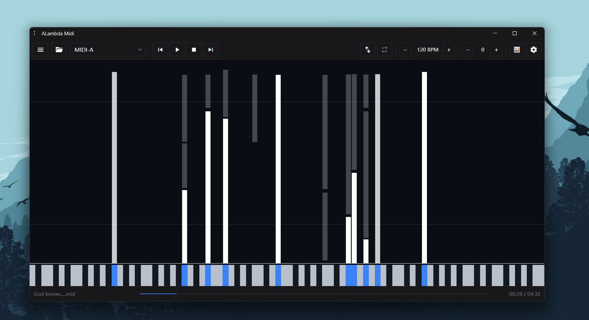
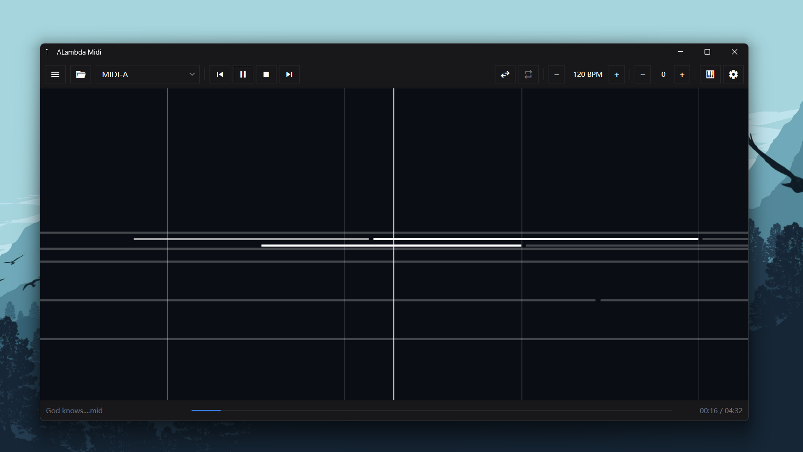
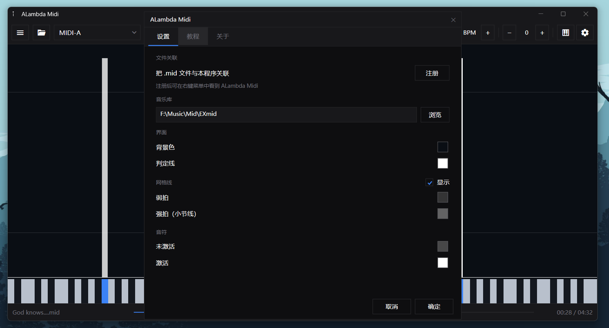
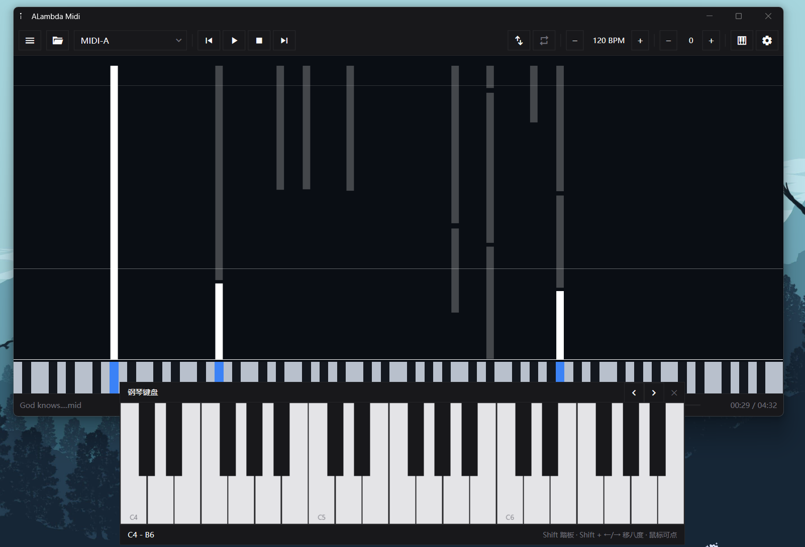
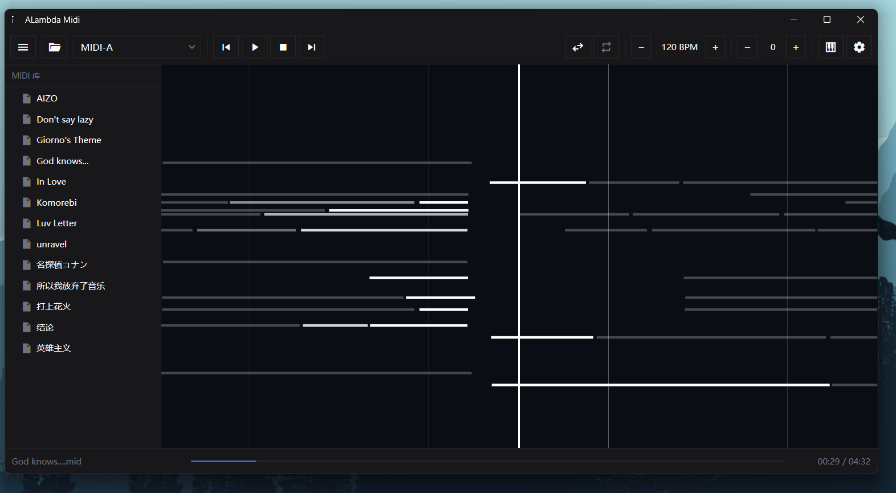

# 简单易用又现代好看的 MIDI 播放 / 可视化软件!

你是否也受够了那些 800 年前的 midi 播放器老旧的界面, 又丑又复杂的 UI ? 你是否也经常苦恼为何 midi 播放器不能使用你更优秀的软音源如 Keyscape, Pianoteq ? 你是否还在找能够同时拥有 播放 midi, 发送 midi, 电脑键盘转 midi 信号, midi可视化的软件? 今天这个软件就是为解决这个问题而诞生的!

**ALambda Midi v2.4**, 一个 MIDI 播放器 + 实时可视化工具，支持发送 MIDI 信号到外部音源（如 Pianoteq、DAW、Microsoft GS Wavetable Synth）

<p align="center">
  
</p>

---

## 界面预览

### 竖版瀑布流

音符从上方落下，底部是钢琴键盘。音符碰到判定线的瞬间开始播放。

<p align="center">
  
</p>

### 横版卷轴

音符从右向左移动，中间是判定线。适合喜欢简洁风格的用户。

<p align="center">
  
</p>

### 设置界面

颜色、音乐库、文件关联全部在这里配置。

<p align="center">
  
</p>

### 钢琴键盘

电脑键盘映射成 MIDI 键盘。支持鼠标点击、滑奏、Shift / 空格踏板、踏板锁定、八度切换，以及琴键悬停和按下 / 松开动画。

<p align="center">
  
</p>

---

## 功能特性

### 播放与 MIDI 发送

- 打开 `.mid` / `.midi` 文件，发送 MIDI 信号到任意系统输出端口
- 自动枚举所有可用 MIDI 端口（Pianoteq、DAW、loopMIDI、Microsoft GS Wavetable Synth 等）
- 播放 / 暂停 / 恢复 / 停止
- 进度条可点击或拖动跳转
- BPM 实时调节（不影响音高）
- 移调 ±12 半音（不影响速度）
- 循环模式：无 / 列表循环 / 随机（**只在当前 MIDI 所在文件夹内**）
- 每次开始播放前自动发送踏板复位信号，避免上一首的 Sustain 残留

### 实时可视化

- **竖版瀑布**：音符下落，底部钢琴键盘参考
- **横版卷轴**：音符从右向左，中间判定线
- 音符碰到判定线时高亮，保持 0.5 秒后淡出
- 节拍网格线（随 MIDI 拍号自动变化）
- 流速可调（通过修改源码常量）

### 音乐库

- 在设置中指定一个文件夹作为 MIDI 库
- 侧边栏树形浏览，支持子文件夹
- 上一首 / 下一首（同文件夹内）
- 循环模式：无 / 列表 / 随机（同文件夹内）

<p align="center">
  
</p>

### 钢琴键盘

- 电脑键盘映射（FL Studio 风格）
- 低八度：`Z S X D C V G B H N J M , L . ; /`
- 高八度：`Q 2 W 3 E R 5 T 6 Y 7 U I 9 O 0 P [ = ] \`
- 鼠标点击、按住拖动滑奏；悬停琴键会高亮
- 琴键高亮采用主题紫白配色，白键 / 黑键底色保持不变
- 琴键有 90ms 按下、160ms 松开的颜色 / 下沉动画，键盘和鼠标都会触发
- `Shift` 或 `空格` 按住踏板；底部「踏板 关/开」按钮可以点击锁定，并实时显示踏板状态
- 踏板踩下时键盘顶部会亮一条细线，和底部状态文字同步
- `Ctrl + ←/→` 或鼠标滚轮切换八度；`Shift + ←/→` 保留旧习惯
- 八度切换有 170ms 滑入动画；白键全部标注音名
- 窗口失去焦点或关闭时自动松开所有音，并发送 CC64=0，避免残留踏板
- 范围 C0 ~ B8（3 个八度可见，最高不会超过 MIDI 127）

### 颜色自定义

- 背景、判定线、网格线（弱拍 / 强拍）、音符（激活 / 未激活）全部可配
- 内置 HSV 颜色选择器（色相环 + SV 正方形 + 滑条 + Hex 输入 + 预设色块）
- 所有颜色保存在 `%AppData%\ALambda Midi\config.json`，可手工编辑

### 文件关联

- 在设置中一键注册 `.mid` / `.midi` 文件关联
- 注册后可在右键菜单中看到 ALambda Midi
- 通过右键“用 ALambda Midi 打开”加载文件后会自动开始播放

### MIDI 编辑器

- 工具栏「MIDI 编辑器」直接打开当前 MIDI；没有打开文件时新建一个空 MIDI
- 编辑器工具栏的「新建」按钮或 `Ctrl + N` 新建空 MIDI（会先询问是否保存当前修改）
- 整页切换到编辑器界面，不是弹出新窗口
- 钢琴窗 / 鼓编辑器一键切换
- 左键放置 / 拖动音符，拖动音符右边缘拉长或缩短，右键删除（右键滑动可连续删除）
- 新建音符会淡入并轻微放大，删除音符会留下 180ms 的缩小淡出残影
- 多选后拖动任意一个选中音符的右边缘，可以一起改变所有选中音符的时值
- 框选后按 `Ctrl+C` / `Ctrl+X` 复制 / 剪切，`Ctrl+V` 粘贴到播放头；`Delete` / `Backspace` 删除
- 剪贴板按「拍」保存，跨 PPQ / 跨文档粘贴也能保持正确时值；粘贴会保留相对时间、音高和力度
- Shift + 拖动框选（在已有选中上叠加，不会清空之前的选中）
- 新音符自动沿用「最近碰过的音符」的长度和力度
- 点击顶部小节标尺移动播放头；播放时播放头走到画面中间后平滑自动跟随滚动
- 编辑器打开时会暂停主界面的可视化重绘，避免两套画布同时渲染
- 播放中 / 试听时，左侧琴键会亮起；纵向放大后，音符内部会显示一条力度条
- 钢琴窗下方的「力度 / 踏板」编辑区：
  - 力度页拖动竖条修改力度，`Shift` 多选可一起修改
  - 踏板页左键拖动添加踏板，右键拖动删除踏板（CC64）
  - 按 `Tab` 在力度 / 踏板之间切换
  - 拖动编辑区上方的分隔条，或双击标题栏，可以上下收起 / 展开
- 网格自适应：滚轮上下滚动，`Shift + 滚轮` 左右滚动，`Ctrl + 滚轮` 横向缩放，`Alt + 滚轮` 纵向缩放
- 自适应网格吸附：缩放时自动在 `1/1` ~ `1/32` 之间切换，状态栏会显示当前吸附精度
- 工具栏 BPM 输入框可直接改 BPM（回车应用，`[` / `]` 每次 ±5）；播放中修改会从当前位置重新开始播放
- 打开已有 MIDI 时，保存窗口默认指回源文件；确认覆盖后源文件 BPM / 拍号会更新
- 保存成功后主界面会自动载入实际保存的文件，BPM / 拍号与磁盘内容一致
- 新建 MIDI 默认保存到音乐/ALambda Midi；已有 MIDI 也可以另存到其他目录
- 调式辅助（8 种调式）、撤销 / 重做
- `Ctrl + S` 快速保存：第一次打开保存窗口，之后直接覆盖上次的文件；工具栏保存按钮始终打开保存窗口
- 保存窗口会完整换行显示保存路径，不会再被截断
- 保存窗口和工具栏的输入框文字垂直居中、完整显示，不会被上下裁掉
- 新建 MIDI 默认保存在 `音乐/ALambda Midi`；已有 MIDI 默认保存回源文件，并记住每个文件的保存位置
- 退出编辑器或关闭程序时会询问是否保存

---

## 快捷键

| 快捷键 | 功能 |
|---|---|
| `空格` | 播放 / 暂停 |
| `Esc` | 停止并回到开头 |
| `←` / `→` | 快退 / 快进 5 秒 |
| `Home` | 回到开头 |
| `↑` / `↓` | 升调 / 降调 ±1（可长按） |
| `Ctrl` + `←` / `→` | 上一首 / 下一首（同一文件夹） |
| `Ctrl` + `O` | 打开文件 |
| `Ctrl` + `H` | 横版 / 竖版切换 |
| `Ctrl` + `L` | 循环模式切换（当前文件夹内） |
| `Ctrl` + `B` | 显示 / 隐藏 MIDI 库 |
| `Ctrl` + `E` | 打开 MIDI 编辑器 |
| `Ctrl` + `N` | 新建空 MIDI（打开编辑器） |
| `Ctrl` + `P` | 钢琴键盘 |
| `Ctrl` + `,` | 打开设置 |
| `Ctrl` + `D` | 停止并复位 |
| `[` / `]` | BPM -5 / +5 |

> v2.0 起取消了「单按 Ctrl / Shift」这类一碰就触发的键位，全部改为明确的组合键，并屏蔽了长按连发，避免误触。

**钢琴键盘窗口**：`Shift` / `空格` 按住踏板，点击底部踏板按钮可锁定；`Ctrl + ←/→` 或鼠标滚轮切换八度。

### 编辑器快捷键

| 快捷键 | 功能 |
|---|---|
| `空格` | 播放 / 暂停 |
| `Esc` | 返回可视化界面（会询问保存） |
| `Ctrl` + `S` | 快速保存（首次打开保存窗口） |
| `Ctrl` + `N` | 新建空 MIDI |
| `Ctrl` + `C` / `Ctrl` + `X` | 复制 / 剪切选中音符 |
| `Ctrl` + `V` | 粘贴到播放头 |
| `Ctrl` + `Z` / `Ctrl` + `Y` | 撤销 / 重做 |
| `Ctrl` + `E` | 返回主界面 |
| `↑` / `↓` | 选中音符移调 ±1 |
| `Shift` + `↑` / `↓` | 移调一个八度 |
| `←` / `→` | 按小节移动播放头 |
| `Home` | 回到开头 |
| `Delete` / `Backspace` | 删除选中音符 |
| `[` / `]` | BPM -5 / +5 |
| `Tab` | 切换力度 / 踏板编辑页 |

---

## v2.4 更新

- **保存目标修复**：打开已有 MIDI 时，保存窗口默认指回源文件；确认覆盖后源文件本身会写入新 BPM / 拍号
- **不会再改副本**：之前默认保存到 `音乐/ALambda Midi` 的副本，导致再次打开源文件仍是旧 BPM；现在已有 MIDI 默认覆盖源文件
- **主界面同步**：保存成功后主界面自动载入实际保存的文件，BPM 与文件一致
- **新建 MIDI**：仍然默认保存到 `音乐/ALambda Midi`，不影响原有另存逻辑

### v2.3 更新

- **保存一致性修复**：修改 BPM / 拍号后保存，tempo 会正确写入 MIDI 文件；保存成功后主界面会自动载入刚保存的文件
- **不再被旧记忆覆盖**：重新打开源 MIDI 时，BPM / 拍号以磁盘文件为准，不会出现「文件还是 120、编辑器却显示上次的 180」
- **保存路径可见**：保存 Toast 会显示完整路径；`Ctrl+S` 仍然覆盖上次保存的文件
- **保存记忆**：源路径和实际保存路径都会记录；保存后继续编辑时快捷保存依然顺手

### v2.2 更新

- **音符剪贴板**：框选后支持 `Ctrl+C` 复制、`Ctrl+X` 剪切、`Ctrl+V` 粘贴到播放头；`Delete` / `Backspace` 删除，操作都会显示 Toast
- **跨 PPQ 剪贴板**：剪贴板按「拍」保存，跨文档 / 不同 PPQ 粘贴也能保持正确时值；保留音高、力度和相对时间
- **钢琴键盘优化**：保持原黑色系，新增琴键悬停高亮、90ms 按下 / 160ms 松开动画、八度切换滑入、窗口淡入
- **配色调整**：钢琴窗蓝白高亮改为主题紫白；其他界面和功能不变
- **踏板状态**：`Shift` / `空格` 按住踏板，底部「踏板 关/开」可点击锁定并实时显示；踏板踩下时键盘顶部亮紫线，失焦 / 关闭自动发送 CC64=0
- **操作手感**：支持 `Ctrl+←/→` 或鼠标滚轮切换八度；白键全部标注音名；范围修正为 C0 ~ B8，空闲时停止重绘

### v2.1


- **新图标**：更换为新的 ALambda Midi 图标（多尺寸 ICO，窗口 / 任务栏 / 安装包统一）
- **编辑器动画**：新建音符淡入放大，删除音符留下 180ms 的缩小淡出残影
- **输入框修复**：修复自定义 TextBox 模板重复应用 Padding 导致 BPM / 保存窗口文字被裁切
- **资源修复**：窗口图标和图标字体改用程序集限定 pack URI，避免从非标准入口启动时报 XAML 资源错误
- **打包**：新增 Inno Setup 安装版（自动检测并安装 .NET 10 桌面运行时）和自包含便携版

### v2.0

- **滚动条**：全局换成极简自动隐藏样式，只在鼠标进入滚动区域时淡入，拖动时变紫
- **快捷键**：取消单按 Ctrl / Shift 的敏感键位，改为组合键并屏蔽长按连发
- **MIDI 编辑器**：工具栏按钮直接打开当前 MIDI（无文件时新建），整页切换、不弹新窗口
- **循环范围**：上一首 / 下一首 / 列表循环 / 随机 只作用于「当前 MIDI 所在文件夹」
- **文件关联**：右键「用 ALambda Midi 打开」后立即开始播放
- **踏板修复**：每次开始播放前向 16 个通道发送 CC123 / CC64=0 / CC66=0 / CC67=0 / CC120，清掉残留踏板与长音
- **动画**：启动淡入、侧边栏滑出、横竖模式交叉淡入、播放按钮脉冲、Toast 提示、按钮 hover / press 过渡、编辑器淡入
- **主题**：保持原来的黑色系与简约直角风格，只用一点紫色做点缀（播放态、选中态、进度条、工具栏细线）
- **新增**：内置 MIDI 编辑器（钢琴窗 / 鼓编辑器、音符编辑、撤销重做、快捷保存）

---

## 安装

### 方式一：安装版（推荐）

1. 从 Releases 下载 [`ALambdaMidi_Setup_v2.4.exe`](https://github.com/Anming1379/ALambda-Midi/releases/download/v2.4/ALambdaMidi_Setup_v2.4.exe)
2. 双击运行，按提示完成安装
3. 安装包不自带 .NET；安装时会自动检测 .NET 10 桌面运行时，未安装则调用内置脚本下载安装

### 方式二：便携版（自包含）

1. 从 Releases 下载 [`ALambdaMidi-Portable-v2.4-win-x64.zip`](https://github.com/Anming1379/ALambda-Midi/releases/download/v2.4/ALambdaMidi-Portable-v2.4-win-x64.zip)
2. 解压到任意文件夹，双击 `ALambdaMidi.exe` 运行，无需安装
3. 已自带 .NET 10 运行时，不需要系统额外安装

---

## 系统要求

- Windows 10 1809 或更高版本（推荐 Windows 11）
- 安装版 / framework-dependent 构建需要 .NET 10 桌面运行时（[下载](https://dotnet.microsoft.com/download/dotnet/10.0/runtime)）；便携版已自带
- 外部 MIDI 音源（如 Pianoteq、DAW、或系统自带的 Microsoft GS Wavetable Synth）

---

## 使用教程

### 快速开始

1. 打开 ALambda Midi
2. 从工具栏下拉框选择 MIDI 输出端口（如 `Microsoft GS Wavetable Synth` 或 `Pianoteq`）
3. 点击“打开”按钮或按 `Ctrl+O`，选择 `.mid` 文件
4. 按 `空格` 播放

### 设置音乐库

1. 按 `Ctrl+,` 打开设置
2. 在“音乐库”区域点击“浏览”，选择一个包含 MIDI 文件的文件夹
3. 点击“确定”，侧边栏会列出该文件夹及子文件夹中的所有 MIDI 文件
4. 点击侧边栏中的文件即可加载并播放

### 注册文件关联

1. 按 `Ctrl+,` 打开设置
2. 在“文件关联”区域点击“注册”
3. 之后右键 `.mid` 文件 → 打开方式 → 选择 ALambda Midi
4. 勾选“始终使用”后，双击 `.mid` 文件即可用 ALambda Midi 打开

### 虚拟 MIDI 接口

如果你想使用 ALambda Midi 配合外部音源（如 Pianoteq、Keyscape 等），需要创建一个虚拟 MIDI 接口。它相当于一根“软件内的 MIDI 线”，把 ALambda Midi 发出的 MIDI 信号“连接”到音源软件。

> **注意**：Windows 自带的 `Microsoft GS Wavetable Synth` 不需要虚拟 MIDI 接口，直接在下拉框选择它就能出声。虚拟 MIDI 接口仅在连接第三方音源时使用。

#### Windows 10：使用 loopMIDI

1. 前往 [loopMIDI 官网](https://www.tobias-erichsen.de/software/loopmidi.html) 下载并安装 loopMIDI
2. 启动 loopMIDI，在底部文本框输入端口名称（例如 `ALambda Midi`），点击左下角的 `+` 按钮创建端口
3. 创建完成后，**保持 loopMIDI 在后台运行**（可最小化到托盘）
4. 打开你的音源软件（如 Pianoteq），在 MIDI 输入设置中选择刚才创建的 `ALambda Midi` 端口
5. 回到 ALambda Midi，在输出端口下拉框中选择同一个 `ALambda Midi` 端口
6. 现在播放 MIDI 时，声音就会由你的音源软件发出

#### Windows 11：使用 Windows MIDI Services

Windows 11 内置了新一代的 MIDI 服务，它使用 **“环回端点对”（A/B 侧）** 来创建虚拟 MIDI 连接，不再像旧版那样只提供一个单一的环回端口[reference:1]。

**第一步：安装 Windows MIDI Services 运行时与工具**

1. 前往 [Windows MIDI Services Releases](https://github.com/microsoft/MIDI/releases/tag/rc-4) 页面
2. 下载并安装 `App SDK Runtime`（x64 版本）以及 `Tools` 包
3. 安装完成后，你的开始菜单中会出现 **MIDI Settings** 应用

**第二步：创建一个环回端点对**

1. 打开 **MIDI Settings** 应用
2. 在顶部工具栏中点击 **Loopback Setup**
3. 在 **MIDI 2.0 Loopbacks** 区域，点击 **New loopback**
4. 输入一个基础名称（例如 `ALambda Midi`）。系统会自动创建两个端点：`ALambda Midi (A)` 和 `ALambda Midi (B)`[reference:2]
5. 点击 **OK** 完成创建。这两个端点默认会持久化保存，重启后依然存在[reference:3]

**第三步：连接 ALambda Midi 与音源**

1. 打开你的音源软件（如 Pianoteq），在 MIDI 输入设置中选择 **`ALambda Midi (B)`** 端口
2. 回到 ALambda Midi，在输出端口下拉框中选择 **`ALambda Midi (A)`** 端口
3. 这样，ALambda Midi 从 A 侧发出的信号，就会从 B 侧进入你的音源软件[reference:4]
4. 播放 MIDI，音源软件就会出声

> **提示**：如果你更习惯传统的单一端口模式，Windows MIDI Services 也提供了 **“MIDI 1.0 Basic Loopback”**。你可以在 Loopback Setup 页面切换到 **MIDI 1.0** 标签，创建一个“基础环回”，它会像 loopMIDI 一样，只生成一个名称的端口，在两端选择同一个名字即可[reference:5]。

---

## 构建与打包

### 1. 还原依赖（使用国内镜像）

```bash
dotnet restore MidiPlayer.csproj -r win-x64 --source https://nuget.azure.cn/v3/index.json
```

### 2. framework-dependent 发布（给 Inno Setup 使用）

```bash
dotnet publish MidiPlayer.csproj -c Release -r win-x64 --self-contained false \
  -p:DebugType=None -p:DebugSymbols=false --no-restore \
  -o dist/publish-framework
```

### 3. 自包含便携版发布

```bash
dotnet publish MidiPlayer.csproj -c Release -r win-x64 --self-contained true \
  -p:PublishSingleFile=true -p:IncludeNativeLibrariesForSelfExtract=true \
  -p:EnableCompressionInSingleFile=true -p:DebugType=None -p:DebugSymbols=false \
  --no-restore -o dist/portable/ALambdaMidi-Portable-v2.4-win-x64
```

打包为 zip：

```powershell
Compress-Archive -Path dist/portable/ALambdaMidi-Portable-v2.4-win-x64/* `
  -DestinationPath dist/ALambdaMidi-Portable-v2.4-win-x64.zip -Force
```

### 4. 编译 Inno Setup 安装包

```powershell
& 'D:\Program Files (x86)\Inno Setup 6\ISCC.exe' installer.iss
```

安装包会输出到 `dist/ALambdaMidi_Setup_v2.4.exe`。安装脚本会使用 `dist/publish-framework` 里的文件，并在缺少 .NET 10 桌面运行时时调用 `Assets/install-dotnet` 里的脚本自动安装。

---

## 关于

- **版本**：v2.4
- **作者**：Anming_cat
- **主页**：https://anmingcat.pages.dev/
- **仓库**：https://github.com/Anming1379/ALambda-Midi
- **协议**：MIT License
- **说明**：代码由 AI 生成

---

## 已知限制

- 不支持内嵌音源，需要外部 MIDI 设备或软件监听
- 部分全新的 Windows 11 系统可能没有 Microsoft GS Wavetable Synth，需自行安装音源
- 安装版不自带 .NET，需要 .NET 10 桌面运行时；便携版已自包含，不需要额外安装
- 自包含便携版体积较大（包含 .NET 运行时）

---

## 协议

MIT License

---

## 致谢

- [DryWetMIDI](https://github.com/melanchall/drywetmidi) — MIDI 文件解析与播放
- [SkiaSharp](https://github.com/mono/SkiaSharp) — 跨平台 2D 绘图
- [Material Symbols](https://fonts.google.com/icons) — 界面图标